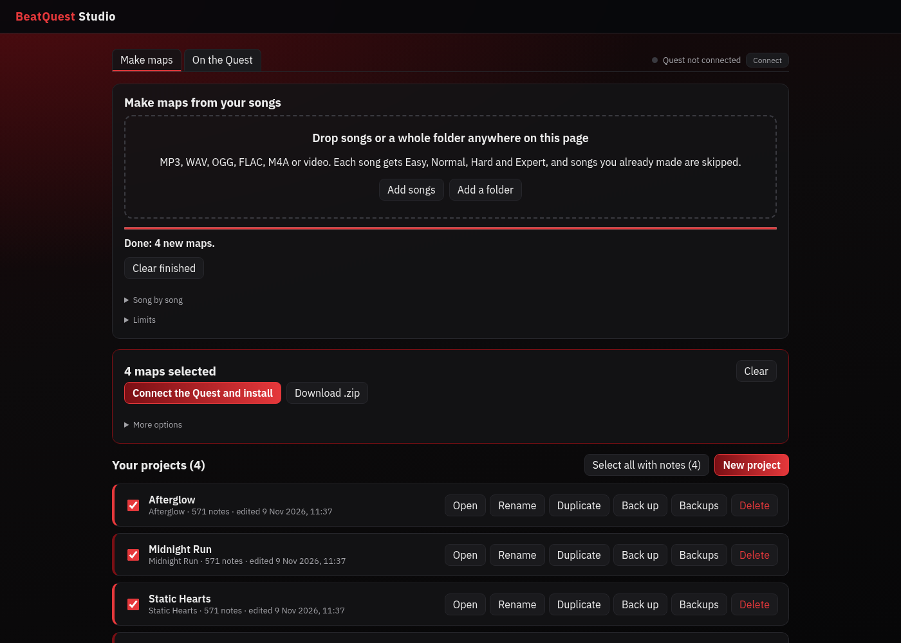
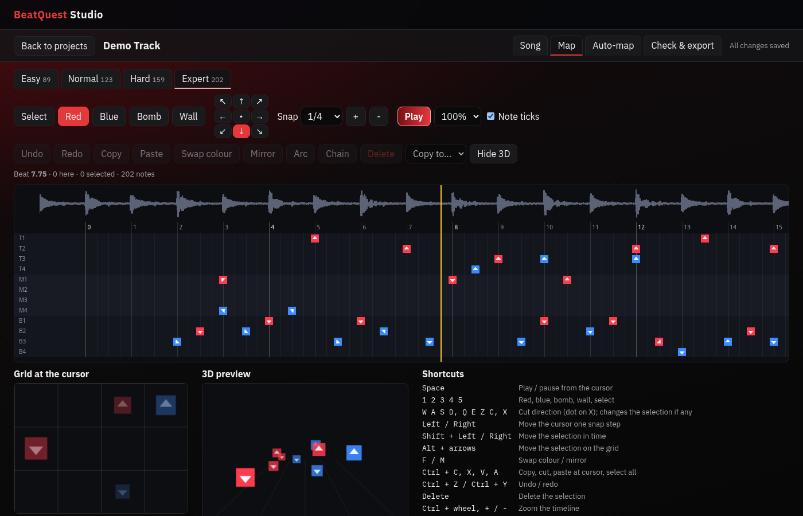

# BeatQuest Studio

**A Beat Saber map maker that runs in Chrome. Drop in a song or a video, get a beat grid that lands on the music, draft Easy, Normal, Hard and Expert automatically, edit every note, and send the map to a modded Quest.**

---

## Overview

BeatQuest Studio is a single web page. Everything happens in your browser: songs,
projects and backups are kept in the browser's own storage on your computer,
and nothing is uploaded anywhere.

- **Import almost anything.** MP3, WAV, OGG, Opus, FLAC, M4A/AAC, WebA, or a
  video (MP4, MOV, WebM, MKV). From a video only the sound is kept.
- **A beat grid that is on the beat.** BPM and offset are measured from the
  attack of every beat, not guessed from loudness, and the Song tab tells you
  how closely the grid fits ("the beats land within 0.9 ms of the music in 90%
  of the song"). Songs that change tempo are flagged.
- **Four real difficulties.** Easy, Normal, Hard and Expert are each drafted on
  their own from the song, never made by deleting notes from Expert. Hard and
  Expert switch to triplets in bars where the music does.
- **Moves like a human map.** Where each note goes is learned from 43 curated
  and ranked community maps: forehand and backhand always alternate,
  downswings sit low and upswings start higher, angles and two-handed hits
  follow how mappers actually place them. Density and note jump speed match
  the typical map at each difficulty (see [How the auto-mapper compares](#how-the-auto-mapper-compares)).
- **A full editor.** Notes, dots, bombs, walls, arcs and chains on a lane
  timeline, a 4 by 3 cell grid, a 3D preview, playback at 25% to 100% with note
  ticks, copy and paste, copy to another difficulty, mirror, swap colours, undo
  and redo, and keyboard shortcuts for all of it.
- **Real names and covers.** Title and artist come from the file's tags, or
  are tidied up from the file name, so
  `03_Artist_-_Song_(Official_Video)_[HD].mp4` becomes "Song" by "Artist".
  Every song gets a cover: its own album art, or a generated one, each with a
  small DrewBeat badge. A cover you upload yourself is never replaced.
- **Batch mode.** Drop a pile of songs or a whole folder anywhere on the page
  and every one becomes its own mapped project, worked through one at a time.
  A song you have already made is spotted by its title, artist and length and
  left alone, so running the same folder again never makes duplicates.
- **Batch install on the Quest.** When a batch finishes its maps are already
  selected, and one button connects the Quest and installs them all over USB.
  Maps already on the headset are detected and skipped unless you ask to
  replace them.
- **Checks, not rules.** Problems such as vision blocks, fast resets or notes
  inside walls are listed as warnings with a Show button; nothing is changed
  without you.
- **Songs on the Quest.** Read every custom song on the headset: title,
  artist, mapper, BPM, difficulties and size, with the ones made here marked.
  Search, sort and remove songs you no longer want.
- **Export and install.** A zip, a folder written straight into
  `CustomLevels`, or an install over USB to the Quest from the browser.

---

## Download

Get `BeatQuestStudio-1.2.0.zip` from the [latest release](../../releases/latest).
It is the built site: unzip it and serve the folder with any static web
server (see [Hosting](#hosting)). Or run it from source:

    npm ci
    npm run dev        # http://127.0.0.1:5173

---

## Making a map

1. **New project**, then on the **Song** tab choose a song or video.
2. Check the **Beat grid**. "Play with beat clicks" plays the song with a tick
   on every beat; nudge the offset or use BPM x2 and /2 if it is off.
3. **Auto-map** drafts the difficulties you tick. A backup is taken first, so
   it can always be undone from the dashboard. There is nothing to tune: the
   same song always gets the same draft, so pressing it again changes nothing.
4. Edit on the **Map** tab. Click a cell in the grid to place a note at the
   cursor, and drag to set its direction. Every shortcut is listed under the
   editor.
5. **Check & export** lists anything worth a look, then downloads the zip,
   saves into a `CustomLevels` folder or installs on the Quest.

### Batch

On the **Make maps** tab, drop songs or a whole folder anywhere on the page, or
use **Add songs** or **Add a folder**. Each file becomes a project named after
it, with all four difficulties drafted. The batch starts by itself, and the
**Song by song** list opens on its own when something needs a look.

Before a song is mapped its title, artist and length are compared with the
projects you already have. If one matches, the song is marked **Already made**
and left alone instead of being mapped a second time; only new songs are
mapped.

When the batch finishes, every map it made or found is selected and a panel
offers **Connect the Quest and install** or **Download .zip**. **More options**
has saving into a `CustomLevels` folder and replacing maps already on the
headset. You can also tick any projects in the list, or use **Select all with
notes**, and send those instead.

So a big batch cannot bring the browser down, it works within these limits:

| Limit | Value | What happens |
|---|---|---|
| Songs in a batch | No limit | Files are only read when their turn comes |
| Songs at once | 1 | Each song is decoded, analysed and saved before the next starts |
| File size | 256 MB | Larger files are skipped before they are read |
| Song length | 15 minutes | Longer songs are skipped after decoding |
| Time per song | 3 minutes | A stuck song is stopped and the batch moves on |
| Browser storage | 100 MB spare | The batch pauses and says so; press Start to carry on |
| Zip size | 256 MB per part | Bigger exports are split into several zips |

The same file size and length limits apply when importing one song.

---

## Getting it onto the Quest

The map goes in
`ModData/com.beatgames.beatsaber/Mods/SongCore/CustomLevels/<map folder>/` on
the headset. Beat Saber needs SongCore installed for custom levels; BeatQuest
Studio does not mod the game itself.

- **Over USB from the browser:** turn on developer mode for the headset in the
  Meta Horizon phone app, plug it in, press **Connect** on the Check & export
  tab and accept "Allow USB debugging" inside the headset. Close SideQuest or
  any other adb program first: only one program can talk to the headset at a
  time.
- **Many at once:** select the maps (a finished batch does this for you) and
  press **Connect the Quest and install**, or **Install N on the Quest** when
  it is already connected. A map is skipped when its folder is already on the
  headset; under **More options** tick **Replace maps already on the headset**
  to install it again, for example after editing it. A map that fails is
  reported and the rest carry on.
- **As a folder:** on Linux the plugged-in headset opens as a folder, so
  "Save into a CustomLevels folder" can write to it directly.
- **By hand:** download the zip, unzip it, and copy the folder into
  `CustomLevels` with any file manager.

### Songs on the Quest

Open the **On the Quest** tab and press **Connect the Quest and read its songs**.
It lists every folder in
`CustomLevels`: the title, artist, mapper, BPM, difficulties and size from each
map's `Info.dat` (both the older and the newer layout), plus the total space
used. Folders made by this app are marked **Made in BeatQuest**, folders with no
readable `Info.dat` are listed with the reason, and the list can be searched and
sorted by title, artist or size. **Remove** asks for a second click and then
deletes just that one folder from the headset. Restart Beat Saber or refresh
songs afterwards to update the list in the game.

---

## Export format

Chosen from maps that already play on a current modded Quest:

| File | Format |
|---|---|
| `Info.dat` | v2.1.0, `Standard` characteristic |
| `EasyStandard.dat` and the rest | v3.3.0 (`colorNotes`, `bombNotes`, `obstacles`, `sliders`, `burstSliders`) |
| `song.egg` | Ogg Vorbis, encoded in the browser when the song is not Vorbis already |
| `cover.png` / `cover.jpg` | Your cover, or one drawn from the title |

Empty difficulties are left out. Beats are written so that beat 0 is the start
of the audio, which keeps every editor and the game in agreement.

---

## Hosting

`npm run build` writes a static site to `dist/`. Any web server can serve it.
Use HTTPS (or `localhost`): Chrome only allows USB and folder access on secure
pages. WebUSB and folder saving need Chrome or Edge on a desktop computer.

---

## How the auto-mapper compares

`scripts/compare-with-reference.ts` runs the auto-mapper on the songs of real
maps and compares the result with the human map for the same song. On 41
curated and ranked maps (medians, human / auto):

| | Easy | Normal | Hard | Expert |
|---|---|---|---|---|
| Notes per second | 1.67 / 1.68 | 2.27 / 2.41 | 3.22 / 3.28 | 3.96 / 4.30 |
| Forehand/backhand alternation | 1.00 / 1.00 | 1.00 / 1.00 | 1.00 / 1.00 | 1.00 / 1.00 |
| Downswings on the bottom row | 0.99 / 0.99 | 0.99 / 0.99 | 0.94 / 0.95 | 0.91 / 0.91 |
| Upswings above the bottom row | 0.82 / 0.81 | 0.86 / 0.84 | 0.89 / 0.85 | 0.92 / 0.90 |
| Two-handed hits | 0.07 / 0.08 | 0.11 / 0.15 | 0.12 / 0.12 | 0.15 / 0.19 |

On 11 maps held back from learning, alternation stays at 1.00 for every
difficulty and Hard and Expert density lands within 3% of the human map.
`scripts/learn-flow.ts` rebuilds `src/generator/flowTable.json` from a folder
of maps; only counts of moves are kept, never the maps themselves.

## Development

    npm test           # unit tests (Vitest)
    npm run typecheck  # strict TypeScript
    npm run build      # production build in dist/
    npm run smoke      # builds, then runs the whole app in headless Chrome

`npm run smoke` drives the installed Chrome (`/usr/bin/google-chrome`, or set
`CHROME_PATH`) and needs `ffmpeg` and `ffprobe`. It makes a test song, encodes
it to every supported format and checks each import finds 128 BPM with the
beat within 5 ms. It then auto-maps, edits with undo and redo, exports, and
checks the zip and its cover with ffprobe. A tagged MP3 with album art and a
messily named video check the song names. Last, it runs a batch with a file
that is too big and one that is not audio, checks the finished batch selected
its own maps, then runs it again to check that every song is now recognised as
already made. A file dropped onto the page and the Quest tab are checked too.
Screenshots go to `smoke-screens/` (or
`SMOKE_SCREENSHOT_DIR`).

| Folder | Responsibility |
|---|---|
| `src/core` | The map model, timing, editing operations and undo history. No browser APIs. |
| `src/audio` | Decoding, waveform, tempo and beat-grid fitting, playback, the analysis worker. |
| `src/import` | Reading a song or video into a project. |
| `src/generator` | The auto-mapper: one profile per difficulty and the learned flow table. |
| `src/validation` | Checks that report problems and never change the map. |
| `src/export` | `Info.dat`, difficulty files, Ogg Vorbis encoding, covers and zips. |
| `src/batch` | The batch queue, its limits, batch mapping, spotting songs already made, and batch export and install. |
| `src/quest` | WebUSB install over adb, reading and removing the songs on the headset, and writing into a `CustomLevels` folder. |
| `src/storage` | IndexedDB projects, audio, covers and backups; autosave. |
| `src/ui` | React screens. |

---

## Credits

USB install uses [Tango](https://github.com/yume-chan/ya-webadb) (MIT). Ogg
Vorbis encoding uses [wasm-media-encoders](https://github.com/arseneyr/wasm-media-encoders)
(MIT). Zips use [fflate](https://github.com/101arrowz/fflate) (MIT). Song
tags are read with [music-metadata](https://github.com/Borewit/music-metadata)
(MIT). The IBM
Plex fonts are under the SIL Open Font License (`src/ui/fonts/OFL.txt`).

Beat Saber is a trademark of Beat Games. This project is not affiliated with
Beat Games or Meta.

---

## License

MIT. See [LICENSE](LICENSE).
